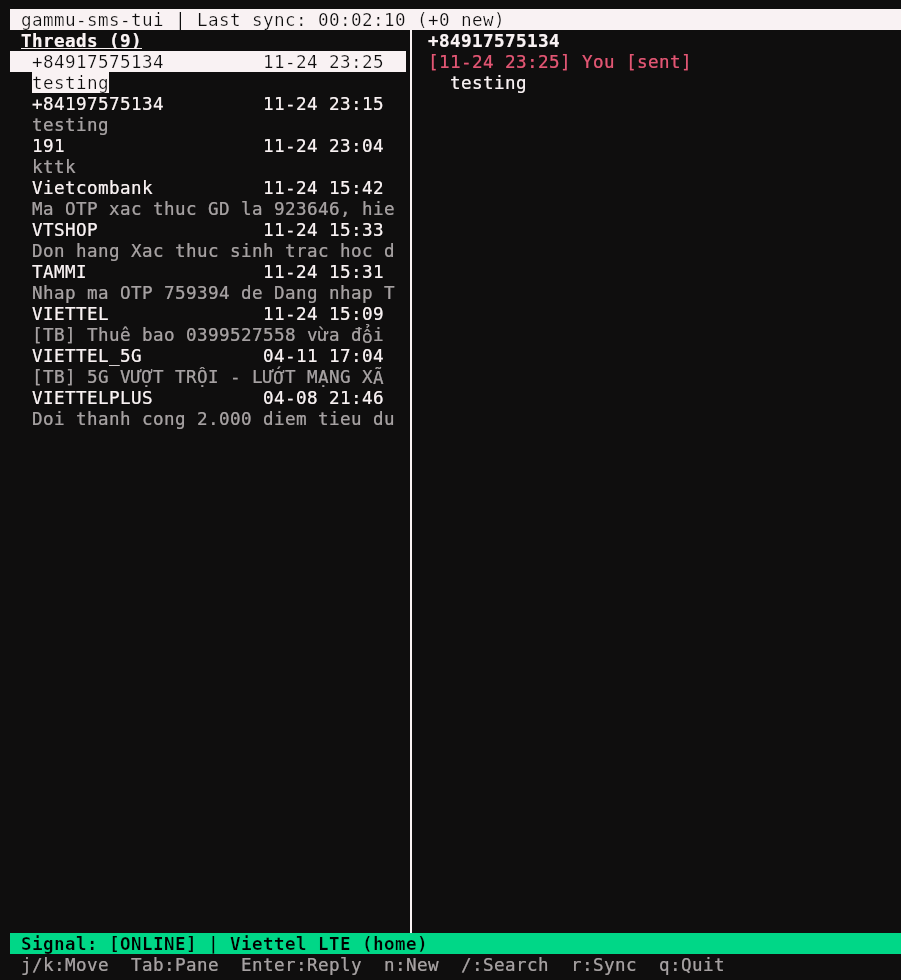
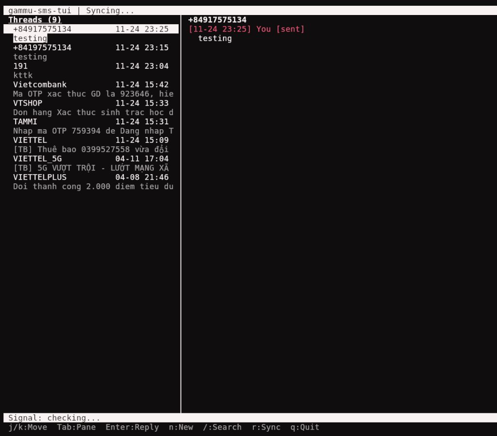

# gammu-sms-tui

Lightweight terminal SMS client for the Fibocom L850-GL (Intel XMM7360) modem using Python's built-in `curses` + `sqlite3` and the `gammu` CLI.



## Requirements

- Python >= 3.11 (stdlib only; no third-party runtime packages)
- `gammu` CLI (`1.45+`)

## Setup & Permissions

1. **Grant non-root access to `/dev/ttyXMM1`:**
   Add your user to `uucp` and install a `uaccess` udev rule (numbered `< 73` so `73-seat-late.rules` applies the ACL immediately without needing a reboot):
   ```bash
   sudo usermod -aG uucp "$USER"
   echo 'KERNEL=="ttyXMM*", TAG+="uaccess", GROUP="uucp", MODE="0660"' | sudo tee /etc/udev/rules.d/70-xmm7360.rules
   sudo udevadm control --reload-rules && sudo udevadm trigger /dev/ttyXMM1
   ```
   Ensure `ModemManager` is **not** running (`ModemManager` locks `/dev/ttyXMM1` and cannot drive `xmm7360` RPC mode).

2. **Configure `~/.gammurc`:**
   ```ini
   [gammu]
   device = /dev/ttyXMM1
   connection = at115200
   ```
   Verify modem access:
   ```bash
   gammu -c ~/.gammurc identify
   ```

> **Note:** On XMM7360 RPC-mode firmware, `gammu getallsms` splits concatenated SMS into separate numbered blocks. This app syncs with `gammu backupsms <staging> -yes` (with crash-safe staging) and reassembles multipart messages via UDH headers.

## Install & Run

Install as a single user command (editable, so repo updates apply immediately):
```bash
uv tool install -e .
```

Run from anywhere:
```bash
gammu-sms-tui
```

Or run directly from the repo without installing:
```bash
PYTHONPATH=src python3 -m sms_tui
```

Optional environment variables:
- `SMS_TUI_DB`: override local SQLite archive path (default: `~/.local/share/gammu-sms-tui/messages.db`)
- `SMS_TUI_LOG`: override rotating log file path (default: `~/.local/share/gammu-sms-tui/sms-tui.log`)
- `GAMMU_CONFIG`: override `~/.gammurc` path

---

## User Flow Guide

### 1. Launch & Initial Sync
Run `gammu-sms-tui`. Any previously archived threads load immediately from SQLite on the left while the background worker syncs new SMS from the SIM (`Syncing...`) and probes network status (`Signal: checking...`).



### 2. Browse, Scroll & Search
- **Switch conversations:** Use `j` / `k` (or `↓` / `↑`) in the left pane. Unread threads are marked with `*` and automatically marked read when selected.
- **Scroll long messages:** Press `Tab` to focus the right message pane, then scroll with `j` / `k` (or `↑` / `↓`).
- **Search:** Press `/` and type to filter threads live by sender name, phone number, or message text. Press `Enter` to keep the filter or `Esc` to clear it.
- **Manual sync:** Press `r` anytime to sync immediately and refresh modem status.

### 3. Reply or Start a New Thread
- **Reply:** Select a thread and press `Enter` (or `i`).
- **New number:** Press `n`, enter the phone number, and press `Enter`. Local Vietnamese numbers (`09...`) and international format (`+849...`) automatically merge into the same thread.
- **Compose & send:**
  - Type UTF-8 / Vietnamese text (`Enter` adds a newline).
  - The compose bar tracks live character count, SMS segment count, and encoding (`GSM7` 160/153 chars vs `UCS2` 70/67 chars).
  - Press `Ctrl-X` to send (`-unicode` is passed automatically when needed), or `Esc` to cancel.
  - Outgoing messages appear immediately as `[sending]` and update to `[sent]` or `[failed]` (with carrier/modem errors shown in the top banner and logged to `sms-tui.log`).

### 4. Signal & Network Status Bar
The bottom status bar queries the modem over AT and highlights by stage:
- **Green:** Registered on home network (`[ONLINE]` or `>= 60%` signal)
- **Amber/Yellow:** Roaming or `25%–59%` signal
- **Red:** `< 25%` signal, `no service`, `denied`, `searching`, or probe unavailable

*(On L850 `xmm7360-pci` firmware where AT `+CSQ`/`+CESQ` return `99`/`255`, registered state displays as `Signal: [ONLINE] | Viettel LTE (home)`.)*

### 5. Background SIM Archiving
SIM storage is small (~30 physical SMS parts). Every sync exports messages to `~/.local/share/gammu-sms-tui/pending-sync.ini` via `gammu backupsms ... -yes`, commits them into SQLite (deduplicated by SHA-256 fingerprint), and only then removes the staging file. Your local conversation history stays intact even as SIM slots are freed in the background.

---

## Keybindings

| Key | Action |
| --- | --- |
| `j` / `k` or `↓` / `↑` | Move thread selection / scroll messages |
| `Tab` | Switch focus between thread list and message pane |
| `Enter` or `i` | Reply in selected thread |
| `n` | Compose to a new phone number |
| `/` | Filter/search threads and message text |
| `r` | Sync now (archives to SQLite, frees SIM slots, refreshes signal) |
| `Ctrl-X` | Send message (in compose mode) |
| `Esc` | Cancel compose / clear search |
| `q` | Quit |

## Troubleshooting & Logs

- **View full `gammu` command output and errors:**
  ```bash
  tail -n 30 ~/.local/share/gammu-sms-tui/sms-tui.log
  ```
- **Mobile data (`wwan0`) alongside `gammu-sms-tui`:**
  If `sudo lte up` hits a `pyroute2` `NetlinkError(95)` on `dst='default'`, bring up the XMM7360 data channel without `ModemManager` using:
  ```bash
  sudo python3 /usr/lib/xmm7360-pci-spat/rpc/open_xdatachannel.py -c /etc/xmm7360 -n
  sudo ip route replace default dev wwan0 metric 1000
  ```

## Development & Tests

```bash
pytest -v
```

### Real-device fixture check

Capture a read-only local backup (gitignored under `tests/fixtures/local/`):
```bash
gammu backupsms tests/fixtures/local/real-inbox.ini -all
PYTHONPATH=src python3 -c "from sms_tui.parser import parse_backup, merge_parts; print(merge_parts(parse_backup('tests/fixtures/local/real-inbox.ini')))"
```
